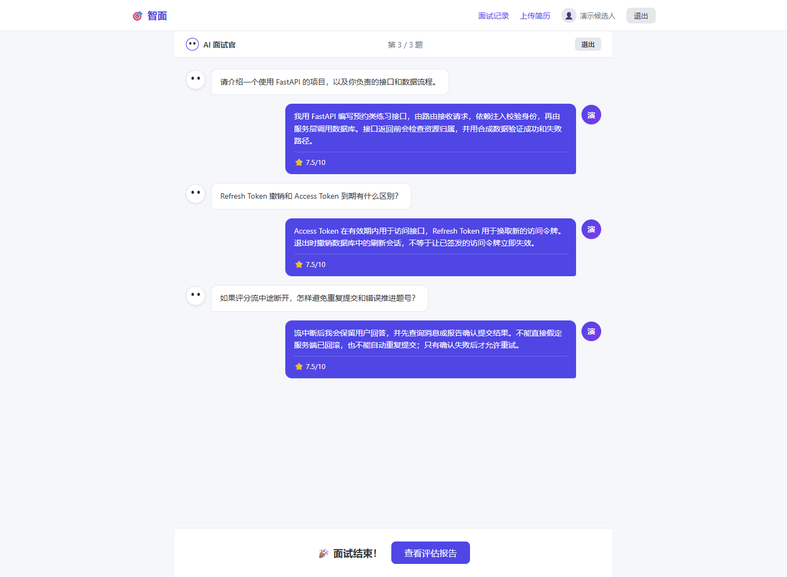
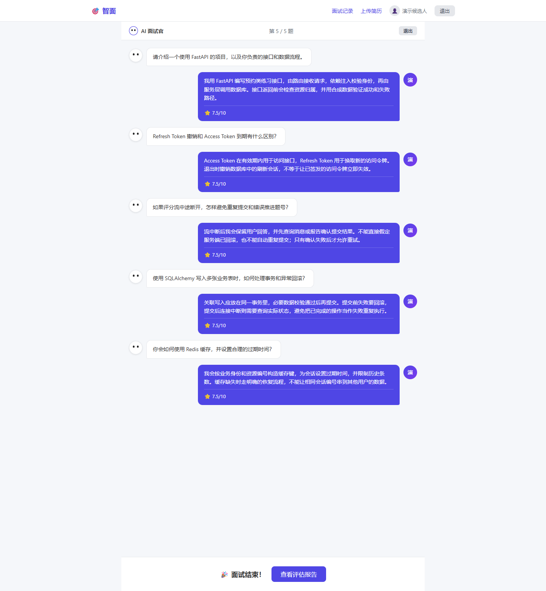
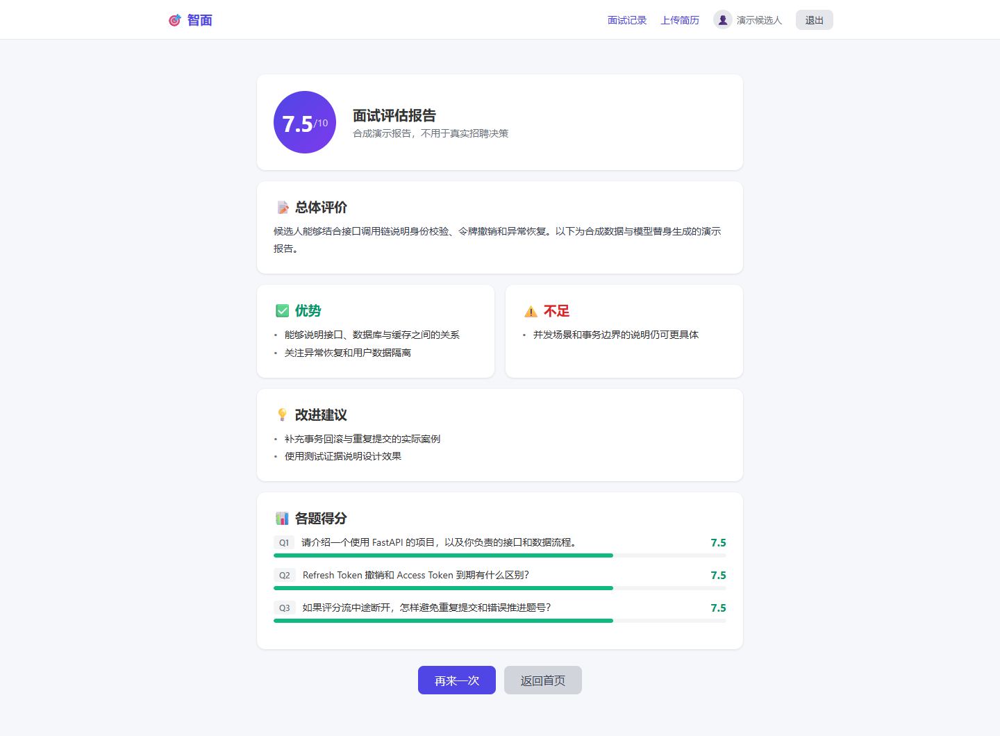
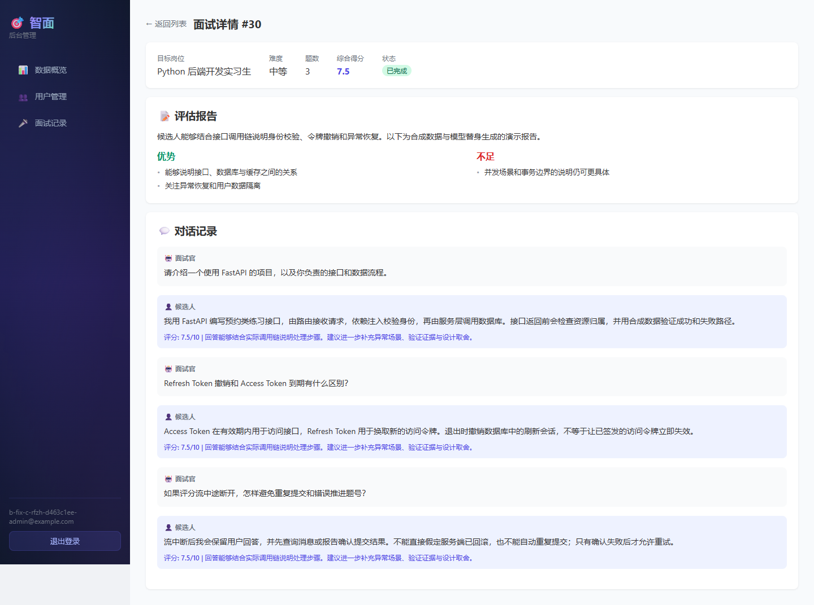

# 智能模拟面试系统（AI Interview）

基于 **FastAPI + Vue 3 + PostgreSQL + Redis + Celery + DeepSeek** 的 AI 面试模拟平台。系统围绕简历上传与解析、个性化出题、多轮模拟面试、逐题反馈和综合评估报告构建，提供用户端和管理后台。

V2 的隔离演示、答题题号契约及断流恢复说明见 [本地演示指南](docs/LOCAL_DEMO.md)。历史生产配置仍未验证。

## 核心功能

### 用户端

- **用户认证**：注册、邮箱验证码验证、登录及个人信息管理。
- **简历上传与分析**：上传 PDF 简历，提取文本，调用 AI 转换为结构化简历信息并进行分析。
- **个性化模拟面试**：结合简历内容和目标岗位生成面试问题；支持逐题作答、面试进度管理。
- **实时 AI 反馈**：通过 SSE 流式返回面试回答评价，记录单题评分和反馈。
- **综合面试报告**：面试完成后汇总成绩、回答表现与改进建议，并支持查看面试记录。

### 管理后台

- 管理员登录、用户管理、面试记录查看与详情展示、数据概览。

## 运行效果

以下为独立验收环境中使用合成账号、合成简历和受控 AI 测试替身产生的真实浏览器截图，不是真实候选人的评估资料。固定评分与报告文案用于验证数据流程，不代表真实模型能力。

### 用户端：三题面试完成



### 用户端：五题面试完成



### 用户端：合成评估报告



### 管理后台：合成面试详情



> 图中用户、岗位、面试问答和报告均为中文合成演示数据；7.5 分及评价由受控 AI 替身固定生成，不代表真实模型评分或真实候选人的能力。

## 技术栈

| 模块 | 技术 |
| --- | --- |
| 后端 | Python、FastAPI、Pydantic、SQLAlchemy Async、Alembic |
| 数据存储 | PostgreSQL、Redis |
| AI 能力 | DeepSeek API、OpenAI 兼容 SDK、结构化输出校验、SSE |
| 异步任务 | Celery |
| 前端 | Vue 3、Vue Router、Pinia、Axios、Vite |
| 部署 | Docker、Docker Compose |

## 架构与业务流程

```text
用户端（ai-interview-frontend）         管理后台（ai-interview-admin）
             |                                  |
             +------------ HTTP API -----------+
                              |
                         FastAPI 后端
                              |
                    API → Service → ORM
                       |            |
                  PostgreSQL      Redis
                       |
                  面试/简历数据

AI 调用：Service → AIService → DeepSeek API
异步任务：Celery / Redis（依据部署配置运行）
```

典型面试流程：

```text
注册 → 邮箱验证 → 登录
  → 上传 PDF 简历
  → 提取简历文本并进行 AI 结构化分析
  → 根据岗位与简历生成面试题
  → 逐题作答并获得评分 / 流式评价
  → 完成面试并生成综合报告
  → 后台查看面试记录
```

## 项目目录

```text
ai-mock-interview-system/
├── ai-interview-backend/       # FastAPI 后端、业务服务与容器部署配置
│   ├── app/
│   │   ├── api/               # 用户端与后台接口
│   │   ├── services/          # 面试、简历、AI 等业务服务
│   │   ├── models/            # 数据模型
│   │   ├── schemas/           # 请求与响应模型
│   │   ├── core/              # 基础配置与组件
│   │   └── schedule/          # 后台任务相关代码
│   └── migrations/            # Alembic 迁移
├── ai-interview-frontend/      # Vue 3 用户端
├── ai-interview-admin/         # Vue 3 管理后台
├── docs/                     # 项目运行截图
│   └── screenshots/
└── README.md
```

## 运行与部署边界

后端需要 Python 3.12、PostgreSQL、Redis；真实 AI 与邮件功能还需要自行配置服务。两个前端基于 Node.js 与 Vite。私有配置参考 `ai-interview-backend/.env.example`，JWT 密钥必须自行设置，不能提交真实 `.env`、密码或 API Key。

**下列后端 Compose、Nginx 和部署脚本属于尚待重新适配的历史配置，不作为可直接运行的推荐部署入口。** 包括：

- `ai-interview-backend/docker-compose.yml`、`docker-compose.dev.yml`：包含固定容器名称、端口、历史目录默认值及 Host Network 等设置。
- `ai-interview-backend/docker-compose.prod.yml`、`scripts/deploy.sh`：仍有旧镜像默认值及服务启停、镜像清理等操作，不应直接用于当前仓库发布。
- `ai-interview-backend/nginx/nginx.conf`、`nginx/prepwise.conf`：上游端口、健康检查和网络配置仍需统一验证。

V2 本地隔离演示使用 `docs/demo/` 下的配置，已在 Windows 宿主机、F 盘私有运行目录和 Docker Desktop Linux 引擎上验证，具体条件见本地演示指南；上述后端历史组合仍未验证。**不提供已验证的一键生产部署命令**。请勿将隔离环境验证等同生产部署成功，也不要直接执行历史部署脚本。

前端通过 `BACKEND_PROXY_TARGET` 指定开发代理目标；后端健康路径为 `/api/v1/config/health`。实际主机、端口、挂载和私有配置应在独立环境中重新确认，不能复用其他项目的数据卷或配置。

## 测试与项目边界

- **历史演示记录**：曾执行注册登录、简历上传与 DeepSeek 分析、五题面试、逐题评分、最终报告和管理端查看。V2 专项未重新验证真实模型调用或其质量。
- **V2 隔离验收**：使用真实 FastAPI HTTP、PostgreSQL、Redis、JWT 和 bcrypt；覆盖认证与文件访问保护，以及合成简历、多轮面试、SSE 和报告落库。注册流程包含邮箱验证，三题和五题进度均有定向复测。Node/Vue 测试和两端构建已通过；页面截图属于既往浏览器演示，V2 专项未重跑人工浏览器全流程。
- **并发正确性专项**：已使用独立真实 PostgreSQL 会话验证普通 HTTP、SSE 及交叉路径的同题并发、旧题迟到重试和异常恢复；工作副本与独立克隆各有 36 个通过场景。这是并发正确性证据，不是性能压测或生产高并发能力证明。
- **受控替身**：AI 出题、评分和报告使用确定性 Mock；邮件投递被拦截并模拟，验证码仍通过隔离 Redis 验证。没有据此证明真实邮件送达、真实 AI 评分质量或第三方服务可用性。
- **统计边界**：历史失败与后续修复复测分开记录，不将跨阶段、续跑或重复前置断言相加作为独立场景数、系统覆盖率或 AI 准确率。
- **未验证范围**：生产高并发性能、性能压测、生产部署、CI/CD，以及真实外部模型质量、真实邮件投递和第三方服务可用性。V2 验收环境中后端既有测试为 86 项通过、13 项警告；其中包含继承重复和示例占位测试，不能把这些当作真实数据库或端到端测试证据，也不代表其他环境已经验证。
- 项目用于技术学习、功能演示与个人求职展示。AI 评价存在不确定性，不应被视为正式招聘决策依据。

后端依赖准备完成后，可单独运行 A1 定向回归（使用隔离夹具，不连接业务数据库或云服务）：

```bash
cd ai-interview-backend
python -m unittest discover -s tests -p test_security_surface.py -v
```

## 后续工程化计划

项目后续将完善 CI/CD 自动化检查、预览环境部署和生产发布回滚能力，具体见 [工程化优化路线图](docs/ENGINEERING_ROADMAP.md)。当前历史部署工作流尚未适配和验证。
